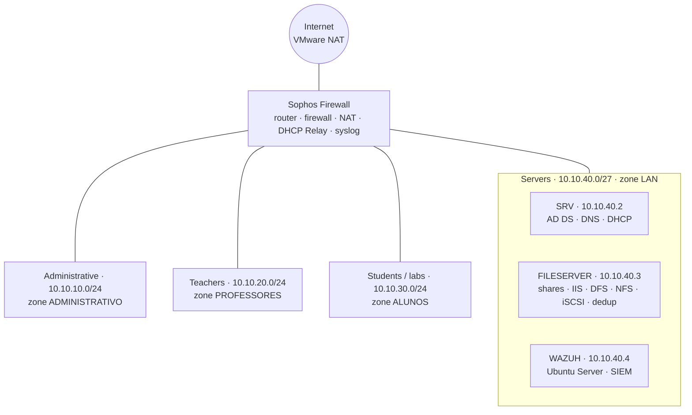

# TechFuture Lab: Windows Server Infrastructure with Hardening and SIEM

A virtualized lab that designs, builds and tests the infrastructure of a fictional college, **TechFuture**, so that students, teachers and administrative staff share one network without sharing access.

It combines network segmentation (Sophos Firewall), centralized identity (Active Directory), per-profile hardening (GPOs, fine-grained password policy, Windows LAPS, key-only SSH) and security monitoring with **Wazuh** as the SIEM, including a custom decoder for Sophos Firewall syslog.

Built as a case study for the Windows course of the Cybersecurity Technology degree at **FIAP** (São Paulo, Brazil), under the supervision of Prof. Eduardo R. S. Popovici.

- 🎥 **Step-by-step video (pt-BR):** https://youtu.be/-BswtDdCLRY
- 📄 **Scientific paper, IEEE format (pt-BR):** [`docs/paper-pt-BR.pdf`](docs/paper-pt-BR.pdf)

---

## The problem

TechFuture has 800 students, 80 teachers, 40 administrative staff, 4 computer labs and about 120 computers, all on one flat infrastructure. A student must never reach what belongs to a teacher or to the administrative office, and the college also needs an internal website (intranet) for announcements.

## Architecture



| Network | Subnet | Gateway | Sophos port | Zone |
| --- | --- | --- | --- | --- |
| Servers | 10.10.40.0/27 | 10.10.40.1 | Port1 | LAN |
| Internet (WAN) | VMware NAT | – | Port2 | WAN |
| Administrative | 10.10.10.0/24 | 10.10.10.1 | Port3 | ADMINISTRATIVO |
| Teachers | 10.10.20.0/24 | 10.10.20.1 | Port4 | PROFESSORES |
| Students / labs | 10.10.30.0/24 | 10.10.30.1 | Port5 | ALUNOS |

Addressing follows RFC 1918 (`10.0.0.0/8`). The third octet identifies the network (10, 20, 30, 40), `.1` is always the gateway, and `.1`–`.9` are reserved for fixed equipment. Segmentation is physical, with one firewall interface per network and **no VLANs**.

### Virtual machines

| VM | Role | Lab sizing (vCPU / RAM / disk) | Reference sizing |
| --- | --- | --- | --- |
| Sophos | Firewall, router, NAT, DHCP Relay, syslog source | 2 / 4 GB / 64 GB | 4 / 4 GB / 64 GB |
| SRV | Domain controller (`techfuture.local`), DNS, DHCP | 2 / 3 GB / 35 GB | 4 / 8 GB / 80 GB |
| FILESERVER | File shares, intranet (IIS), DFS, NFS, iSCSI, deduplication | 2 / 3 GB / 4 disks | 4 / 8 GB / 250 GB |
| WAZUH | SIEM on Ubuntu Server 24.04 | 2 / 4 GB / 40 GB | 4 / 8 GB / 50 GB |
| PCCLIENTE | Windows 11 test client, moved between networks to act as each profile | 2 / 4 GB / 64 GB | 2 / 8 GB / 64 GB |

The *lab* column is what ran on a 24 GB laptop with VMware Workstation. The *reference* column follows each vendor's recommendation for a real deployment.

> **Naming note.** The lab was built in Portuguese, so Active Directory objects keep their original names: `Alunos` = Students, `Professores` = Teachers, `Administrativo` = Administrative staff, `Estacoes` = Workstations, `Servidores-Membro` = Member servers, `Compartilhamentos` = Shares. The scripts use these names exactly, so they match the paper and the video.

## What was implemented

**Network (Sophos Firewall)**
- One zone per user network (`ADMINISTRATIVO`, `PROFESSORES`, `ALUNOS`) plus `LAN` for the servers
- Default deny, with only three allow rules: users → servers, users → internet (with NAT), servers → users. There is no rule between user networks, so that traffic falls through to the final *Drop all*
- DHCP Relay on Port3–Port5, forwarding to the DHCP server on SRV, so the networks stay segmented while DHCP stays centralized

**Identity and access (SRV)**
- Domain `techfuture.local`, with OUs for people (Administrativo, Professores, Alunos) and for computers (Servidores-Membro, Estacoes)
- Security groups `GG-Administrativo`, `GG-Professores`, `GG-Alunos` and `GG-TI` receive permissions, while OUs receive GPOs
- Four DHCP scopes, plus DHCP reservations for FILESERVER and WAZUH

**Files and services (FILESERVER)**
- One folder per profile with inheritance cut, so only the owning group, SYSTEM and Administrators have access
- Open share permissions with restrictive NTFS (the most restrictive of the two applies)
- `Transfer` exchange folder: everyone reads and creates, and only the creator (`CREATOR OWNER`) can change or delete
- Intranet on IIS with Windows authentication, DFS namespace `\\techfuture.local\Arquivos`, read-only NFS export for the Wazuh host, a 5 GB iSCSI LUN mounted on SRV, and data deduplication
- Shadow copies twice a day, a weekly Robocopy backup to SRV, and BitLocker (XTS-AES-256, TPM) on C: and D:

**Hardening**
- Fine-grained password policy (PSO): 14 characters, lockout after 10 failed attempts for 15 minutes
- Baseline GPO: SMB signing required, users cannot install software
- Per-profile GPOs following least privilege. Students get no Command Prompt, PowerShell, Control Panel or USB storage. Teachers get a limited Control Panel and read-only USB. Administrative staff get a screen lock only
- Logon auditing (Logon and Special Logon subcategories) on all Windows machines
- Windows LAPS with encrypted passwords stored in AD, readable by `GG-TI`, plus DSRM password backup for the domain controller
- SMBv1 confirmed disabled, Print Spooler disabled on servers (PrintNightmare), built-in local Administrator renamed
- SSH with an RSA 4096 key pair. Password login is disabled on Linux and Windows, root login is disabled on Linux, ciphers are limited to AES-GCM/CTR, and on Windows SSH is only accepted from the server network

**Monitoring (Wazuh)**
- Agents on SRV, FILESERVER and PCCLIENTE, Sysmon on the servers
- File integrity monitoring in real time on the shared folders
- Sophos Firewall logs received via syslog and parsed with a **custom decoder and rule** (see [`wazuh/`](wazuh/)), because the stock Sophos decoders did not match this firmware's log format

## Results

**DHCP Relay.** The test client received an address from SRV through the Sophos relay in each network:

| Network | IP obtained | Gateway | DNS |
| --- | --- | --- | --- |
| Students | 10.10.30.10 | 10.10.30.1 | 10.10.40.2 |
| Teachers | 10.10.20.10 | 10.10.20.1 | 10.10.40.2 |
| Administrative | 10.10.10.10 | 10.10.10.1 | 10.10.40.2 |

**Isolation between profiles** (file shares):

| User | Alunos | Professores | Administrativo | Transfer |
| --- | --- | --- | --- | --- |
| student | Access | Denied | Denied | Read and create |
| teacher | Denied | Access | Denied | Read and create |
| admin staff | Denied | Denied | Access | Read and create |

**Network flows through Sophos:**

| Source → Destination | Test | Expected | Result |
| --- | --- | --- | --- |
| Students → Servers | DNS and LDAP | Allowed | Allowed |
| Servers → Students | WinRM | Allowed | Allowed |
| Students → Internet | HTTPS | Allowed with NAT | Allowed |
| Students → Administrative | SMB | Blocked | Blocked |

**Controls verified:** the effective password policy for the test student, a different LAPS password on each machine, SSH accepted with the key and refused with a password, the student GPO blocking Prompt, PowerShell and Control Panel, BitLocker reporting C: and D: as fully encrypted, and a file restored from shadow copies.

**Monitoring:** FIM recorded file creation, modification and deletion in the shared folder, failed logons produced event 4625, and each connection logged by Sophos produces a Wazuh alert with source, destination, port, zone and firewall rule name.

## Problems we hit and how we fixed them

These were the most instructive part of the project. The full list is in [`docs/troubleshooting.md`](docs/troubleshooting.md).

- **Clients stuck on 169.254.x.x.** The Sophos user ports were unbound (no IP, no zone), the user zones did not exist yet, and the relay entries pointed to the wrong server. Creating the zones, binding the ports and pointing the relay to `10.10.40.2` fixed it
- **`Invoke-Command` worked for FILESERVER but timed out for PCCLIENTE.** FILESERVER sits on the server network, while PCCLIENTE is behind the firewall. Sophos blocks new connections in any direction unless a rule allows them, and only users → servers existed, so a servers → users rule was added
- **Sophos syslog never reached the SIEM.** Three causes stacked up: the log types were not ticked for the syslog server in Sophos, the Wazuh manager was not listening on UDP 514, and no stock decoder matched the log format. The fix was ticking the log types, adding a syslog `<remote>` block and writing a custom decoder

## Repository layout

```
.
├── README.md
├── LICENSE
├── docs/
│   ├── paper-pt-BR.pdf        # IEEE-format paper (Portuguese)
│   ├── sophos-firewall.md     # web console configuration, step by step
│   └── troubleshooting.md     # problems found during the build and their fixes
├── scripts/                   # PowerShell / bash per phase, run block by block
│   └── README.md
└── wazuh/                     # custom Sophos Firewall decoder, rules and sample log
    └── README.md
```

## Limitations

- **No redundancy.** SRV alone holds AD, DNS and DHCP, and one Sophos is firewall, router and relay
- Shadow copies live on the same disk as the data, and Robocopy `/MIR` keeps no history
- The intranet uses HTTP without TLS
- Logon auditing and the local Administrator rename were applied per machine, not by GPO, so a new machine would not inherit them
- NFS and iSCSI were demonstrated, not used in production
- Everything ran on one laptop, with the Wazuh VM below the recommended sizing, and on Sophos Firewall Home Edition

Next steps would be a second domain controller with DHCP failover, DFS replication, HTTPS on the intranet, VLANs, auditing by GPO and a clustered Wazuh.

## Team

Gabriel Cirone Galter · Fernando Giuseppe Avila Beltramo · Matheus de Alencar Castro · Maick Rosario Yamassaki

Advisor: Prof. Eduardo R. S. Popovici, FIAP

## License

[MIT](LICENSE)
